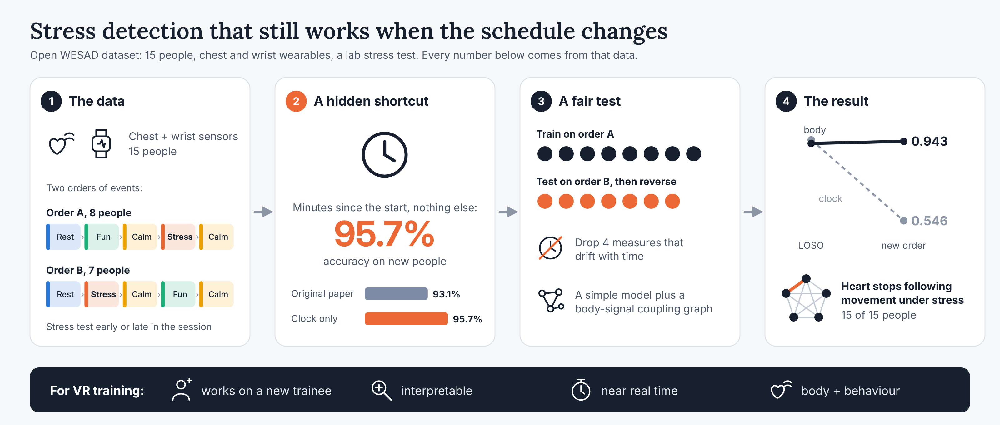
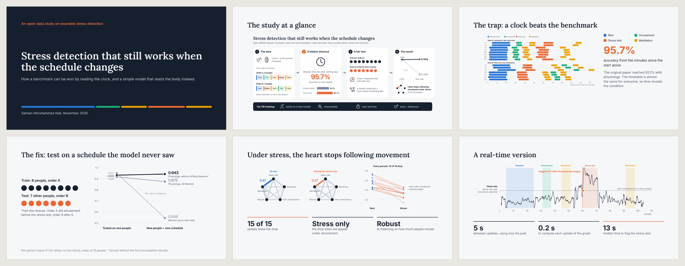
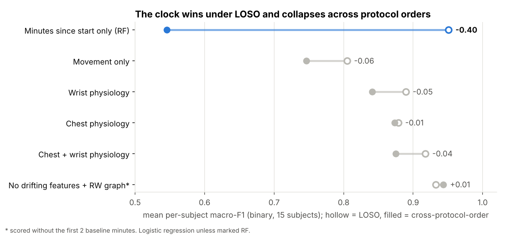
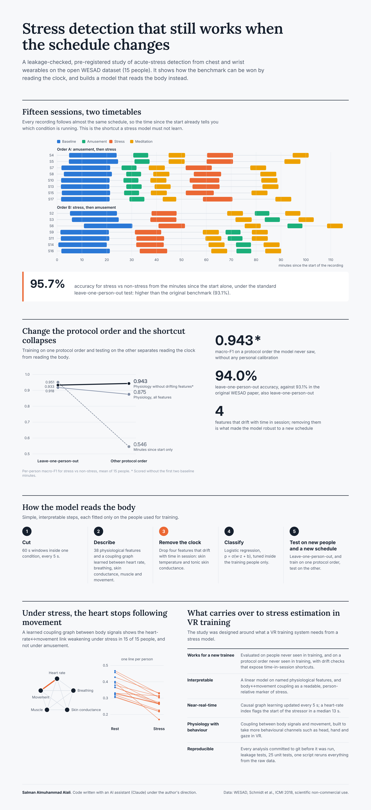

# Stress detection on WESAD: shortcuts, generalisation and physiological coupling graphs

A leakage-safe, pre-registered analysis of acute-stress detection from wearable physiology on the open
[WESAD](https://archive.ics.uci.edu/dataset/465/wesad+wearable+stress+and+affect+detection) dataset
(Schmidt et al., ICMI 2018), with a focus on **what generalises across people and across protocol order**.

The full end-to-end report (fundamentals, methods, results, discussion) is in [`docs/REPORT.md`](docs/REPORT.md).

<p align="center"></p>

## Presentation and visual summary

**Slides (16 pages, PDF):** [`docs/presentation.pdf`](docs/presentation.pdf), the project in plain language, from the
data and the clock shortcut to the real-time version and what carries over to VR.

<p align="center"><a href="docs/presentation.pdf"></a></p>

**One-page visual summary:** [below](#one-page-visual-summary), full size in [`figures/report/portfolio.png`](figures/report/portfolio.png).

## Key findings

1. **A clock beats the original paper.** Minutes since the start of the recording alone reach **95.7 %**
   pooled accuracy for stress vs non-stress under leave-one-subject-out (paper: 93.1 %), because the
   protocol schedule is almost identical for everyone.
2. **Cross-protocol-order evaluation removes the shortcut.** Training on one protocol order and testing on
   the other drops the clock to 66.9 %, while physiology keeps per-subject macro-F1 at 0.88–0.94.
3. **Drifting features hurt generalisation.** Removing four slowly drifting features (absolute temperature,
   tonic skin-conductance level) raises cross-order binary macro-F1 from 0.889 to **0.943** without any
   calibration, and fixes the worst subject (S2, detached temperature sensor).
4. **Stress decouples heart rate from movement.** The heart-rate↔movement coupling weakens under stress in
   15/15 subjects, survives matching on movement level, and does not occur under amusement.
5. **Graph methods did not give significant accuracy gains** (pre-registered tests, Holm-corrected, n = 15),
   and the model calls 36 % of (never-seen) meditation windows "stress": slow deep breathing resembles
   breathing during the spoken stress test.
6. **A learned total-variation graph, tracked causally in real time, confirms the decoupling but adds
   nothing to heart rate.** A synthetic test exposed false fusion in the planned joint model before any
   WESAD data was used; the amended convex online version works, but heart rate minus its rest level stays
   the best index (per-subject AUC 0.94 chest), and correcting heart rate for movement hurts because the
   stress test itself involves movement.

| Binary task, per-subject macro-F1 (mean of 15) | LOSO | Cross-protocol-order |
|---|---|---|
| Minutes since start only (random forest) | 0.951 | 0.546 |
| Movement only | 0.805 | 0.746 |
| Wrist physiology | 0.889 | 0.841 |
| Chest physiology | 0.879 | 0.874 |
| Chest + wrist physiology | 0.918 | 0.875 |
| Chest + wrist, no drifting features, + random-walk coupling graph | 0.933* | 0.943* |

\* scored without the first two baseline minutes (see report, section 9). Logistic regression unless stated.

<p align="center"></p>

## Method in one paragraph

60 s windows (step 5 s) inside one condition; tasks as in the paper (stress vs baseline + amusement;
baseline / stress / amusement). 38 physiological level features (ECG/HRV, wrist pulse, EDA, respiration,
temperature, EMG) and, per window, **coupling graphs** between heart rate, respiration, phasic EDA, EMG
and movement, estimated by correlation, partial correlation, and **random-walk diffusion-kernel graph
inference** (min ‖T̃ − α·expm(−L(w))‖² + λΣw, exact matrix-exponential gradient, unit-tested).
A second family of graphs is **learned from the total variation of the signals on the graph** (Kalofolias
log-degree graph learning, per window and as a causal time-varying graph with an l1 penalty on graph changes),
compared with the classic additional-heart-rate index.
Evaluation by leave-one-subject-out **and** cross-protocol-order, everything fitted inside the training
folds, per-subject metrics, paired Wilcoxon tests with Holm correction. Every stage's settings were
committed to [`docs/analysis_plan.md`](docs/analysis_plan.md) **before** it was run (see the commit history).

## Repository layout

```
scripts/        prepare_wesad.py (shrink WESAD to per-subject .npz), eda_audit.py, eda_figures.py (data audit)
src/wesad/      windows.py, evaluation.py (LOSO + leakage checks), physio.py (signal processing, features),
                graphs.py (dependency matrix, partial correlation, random-walk graph inference),
                tvgraph.py (joint graph-TV denoising + graph learning), tvgraph_online.py (causal time-varying graph)
experiments/    m1_* shortcuts and cross-order check · m2_* features and descriptive effects ·
                m3_* classifiers and tests · m4_* personalisation, no-clock sensitivity, G2 smoothing ·
                m5_interpret.py (decoupling robustness, ablation, self-reports, meditation, failures) ·
                m6_* / m6c_* learned TV graphs: synthetic gates, WESAD features, decoupling index, tests ·
                m7_* report figures, visual panels and the one-page summary
tests/          leakage, windowing and graph-inference tests (pytest)
results/        summary tables (CSV) per milestone; per-window data is not redistributed
figures/        all figures
docs/           REPORT.md, analysis_plan.md (pre-registration), data audit, milestone reports,
                presentation.pdf (slides)
LICENSE         code licence (PolyForm Noncommercial 1.0.0)
LICENSE-docs    docs, figures and results licence (CC BY-NC 4.0)
CITATION.cff    citation metadata (GitHub "Cite this repository")
```

## One-page visual summary

<p align="center"></p>

## Reproduce

1. Download WESAD (2.5 GB) from the [official link](https://uni-siegen.sciebo.de/s/HGdUkoNlW1Ub0Gx) and
   unzip it to `data/WESAD/` (folders `S2` … `S17`). Raw data is not included here (dataset terms).
2. `pip install -r requirements.txt` (Python 3.13 was used).
3. `bash run_all.sh` — runs the whole pipeline in order (about 1.5 hours on 2 CPU cores, 8 GB RAM).
   The last step (M7 visuals) also needs a browser for Playwright: `playwright install chromium`,
   or set `CHROME_PATH` to an installed Chrome.

## How to cite

If you use this code, its results or its figures, please cite the repository (GitHub's **"Cite this repository"**
button gives the same reference from [`CITATION.cff`](CITATION.cff)):

> S. Almuhammad Alali. *Stress detection on WESAD: shortcuts, generalisation and physiological coupling graphs.*
> 2026. https://github.com/SAamal1076/wesad-stress-graphs

```bibtex
@software{almuhammadalali2026wesad,
  title  = {Stress detection on {WESAD}: shortcuts, generalisation and physiological coupling graphs},
  author = {Almuhammad Alali, Salman},
  year   = {2026},
  url    = {https://github.com/SAamal1076/wesad-stress-graphs}
}
```

If you use the random-walk graph inference, please also cite the papers below.

## Related publications

The random-walk graph-inference method used for the coupling graphs (`src/wesad/graphs.py`) comes from:

- S. Al-Muhammad Al-Ali, M. Youssf, J. Rizkallah, M. Hassan, A. Karfoul. *An efficient graph structure
  inference strategy based on random walk model on graph: application to functional brain networks.*
  2019 Fifth International Conference on Advances in Biomedical Engineering (ICABME), IEEE, pp. 1–4, 2019.
- A. Karfoul, S. Almuhammad Alali. *Unfolded ADMM for graph structure inference based on random walk
  model.* European Signal Processing Conference (EUSIPCO), 2026.

```bibtex
@inproceedings{al2019efficient,
  title={An efficient graph structure inference strategy based on random walk model on graph: Application to functional brain networks},
  author={Al-Ali, Salman Al-Muhammad and Youssf, Mazen and Rizkallah, Jeniffer and Hassan, Mahmoud and Karfoul, Ahmad},
  booktitle={2019 Fifth International Conference on Advances in Biomedical Engineering (ICABME)},
  pages={1--4},
  year={2019},
  organization={IEEE}
}
@inproceedings{karfoulunfolded,
  title={Unfolded ADMM for Graph Structure Inference Based on Random Walk Model},
  author={Karfoul, Ahmad and Alali, Salman Almuhammad},
  booktitle={European Signal Processing Conference (EUSIPCO)},
  year={2026}
}
```

## Licence: free for non-commercial use, commercial use by licence

This work is **free for everyone for non-commercial use**: research, teaching, study, personal projects,
and use by universities, public research institutes, non-profits and government bodies.
**Commercial use is not permitted without a commercial licence** from the author.

- **Code** (`src/`, `experiments/`, `scripts/`, `tests/`, `run_all.sh`):
  [PolyForm Noncommercial License 1.0.0](https://polyformproject.org/licenses/noncommercial/1.0.0) (see `LICENSE`).
- **Report, documentation, figures, presentation and result tables**:
  [CC BY-NC 4.0](https://creativecommons.org/licenses/by-nc/4.0/) (see `LICENSE-docs`). Credit the author when you reuse them.
- **Commercial licence** (for example, use in a product, a paid service or company R&D): contact the author,
  [Salman Almuhammad Alali](https://github.com/SAamal1076).
- **Dataset**: WESAD is not included and stays under its own terms (scientific, non-commercial use).
  P. Schmidt, A. Reiss, R. Duerichen, C. Marberger, K. Van Laerhoven, *Introducing WESAD, a multimodal
  dataset for wearable stress and affect detection*, ICMI 2018.

## Authorship and AI assistance

This project was carried out with an AI assistant (Anthropic's Claude) for the code, the report writing and
the visualisations.

Project direction, research questions, decisions and review: the author. The code and the reports were
written and run with the AI assistant under the author's direction, milestone by milestone; every milestone
was reviewed and approved before the next one started. The random-walk graph-inference objective follows the
author's own published work (Al-Ali et al. 2019; Karfoul & Almuhammad Alali 2026; see
[Related publications](#related-publications)).
