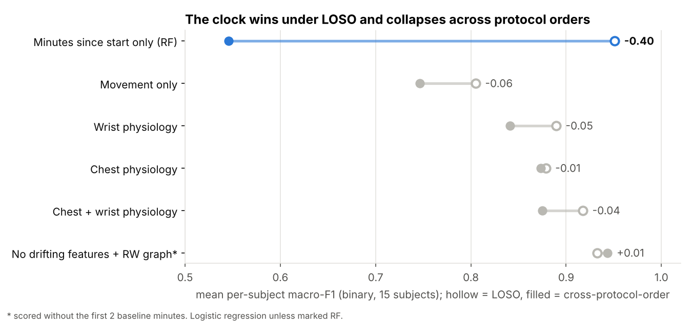
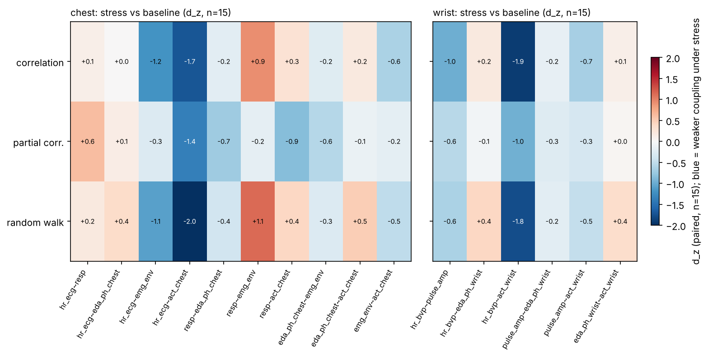
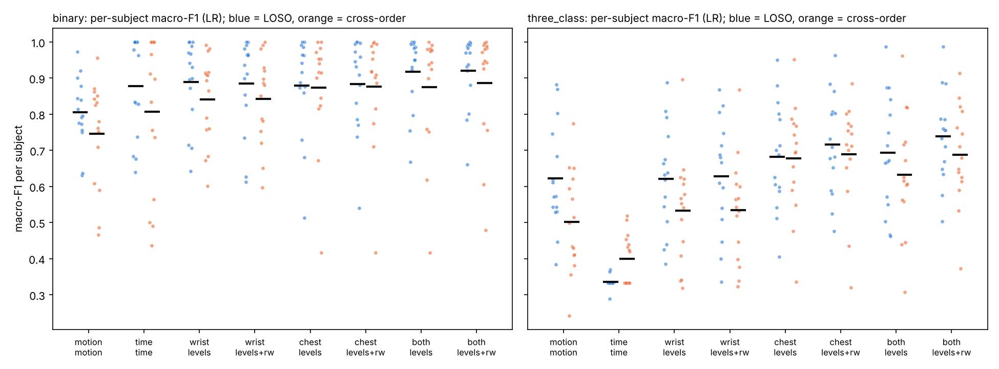
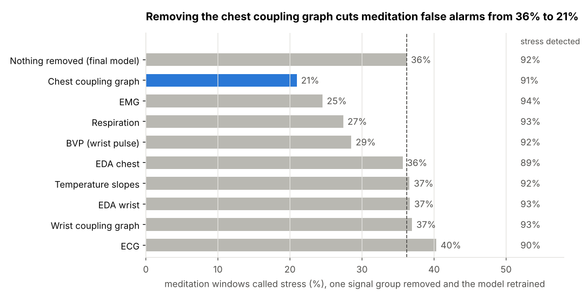
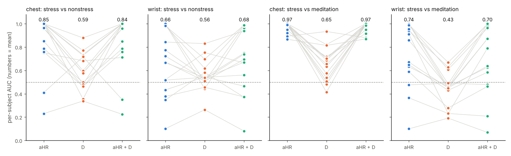
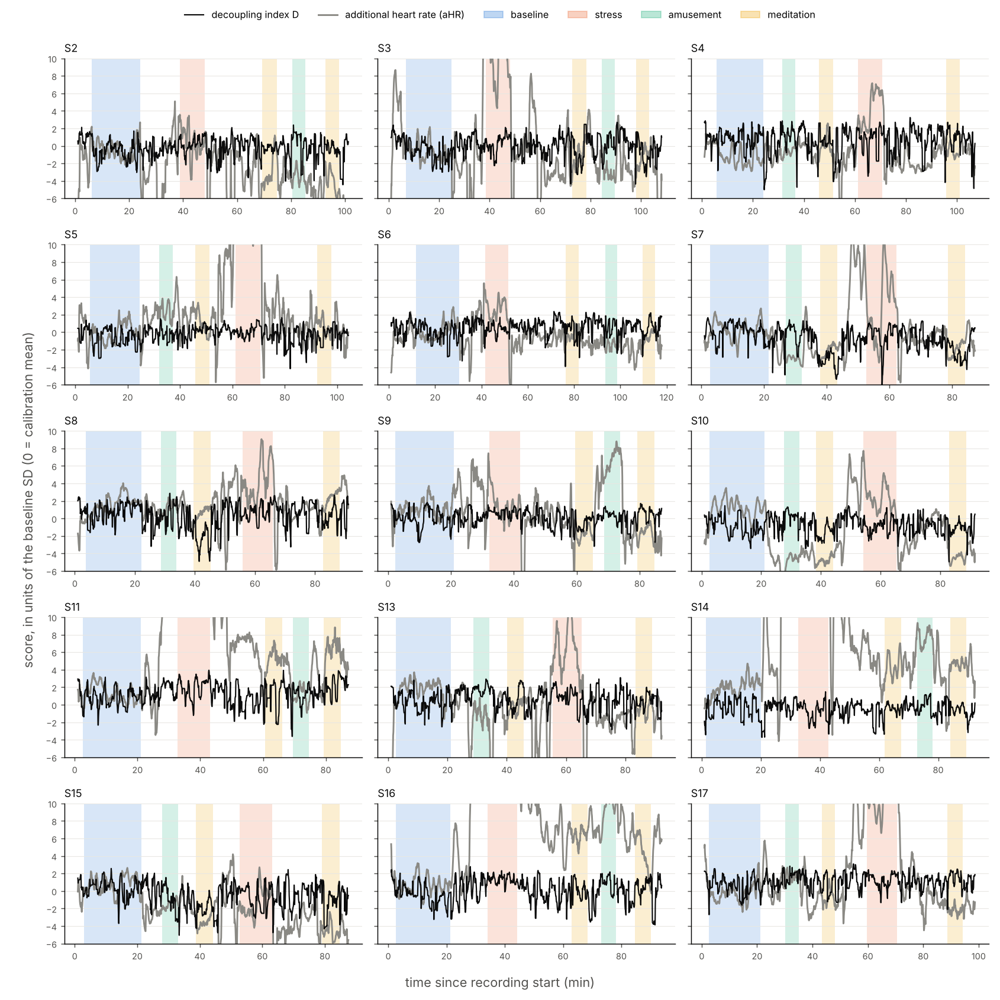

# Stress detection on WESAD: shortcuts, generalisation and physiological coupling graphs

*End-to-end report, 8 November 2026 · Salman Almuhammad Alali.*

## Summary

On the WESAD dataset, physiology detects the stress condition across people with per-subject macro-F1 of 0.94 even when the protocol order changes, but a model that only reads the clock beats the original paper under the standard evaluation. The graph methods built for this project, including a learned total-variation graph tracked causally and online, did not give statistically supported gains; the robust contributions are about how stress models should be evaluated.

**Question.** Can a model trained on some people recognise acute stress in a new person from wearable signals, in a way that would transfer to virtual-reality training? Stress here means the Trier Social Stress Test (TSST) condition of WESAD, compared with rest and amusement.

**Approach.** 15 subjects, 60 s windows, leave-one-subject-out evaluation plus a new cross-protocol-order test, 38 physiological features, per-window coupling graphs between signals (including a random-walk diffusion-kernel graph inference), personalisation by a 2-minute rest calibration, causal test-time graph smoothing, and a graph learned from the total variation of the signals, tracked causally over each whole recording. Every analysis was fixed in a written plan before it was run.

**Key findings**

1. **The clock beats the paper.** Minutes since the start of the recording alone give 95.7% pooled accuracy for stress vs non-stress (paper: 93.1%), because the protocol schedule is almost the same for everyone. Training on one protocol order and testing on the other drops this shortcut to 66.9%.
2. **Physiology generalises.** Chest + wrist physiology keeps per-subject macro-F1 at 0.92 (LOSO) and 0.88 (cross-order). Removing four slowly drifting features raises cross-order F1 to 0.943 without any calibration.
3. **Graphs did not add significant accuracy.** Coupling-graph features add 0 to 4 points; with 15 subjects none of the pre-specified tests survives Holm correction. Graph smoothing of predictions equals a moving average.
4. **Stress decouples heart rate from movement.** The heart-rate↔movement coupling weakens under stress in 15 of 15 subjects, survives matching on movement level, and does not appear under amusement.
5. **The model's "stress" partly means "unusual breathing".** Never trained on meditation, it calls 36% of meditation windows stress, because slow deep breathing resembles breathing during the spoken stress test.
6. **A learned total-variation graph confirms the decoupling but adds nothing to heart rate.** Made convex and causal after a synthetic test exposed false fusion, it tracks coupling causally, update by update; heart rate minus its rest level still detects stress best (per-subject AUC 0.94 chest), and correcting heart rate for movement hurts because the stress test itself involves movement.

**Bottom line.** High WESAD accuracies are easy to obtain and easy to over-read. The useful lessons for stress estimation in VR are to test across scenario order, to watch features that drift with time in session, and to check models on states they were not trained on.

## 1. Background: what stress does to the body, and what each sensor sees

Acute psychological stress shifts the autonomic nervous system towards sympathetic activation and away from parasympathetic (vagal) activity. The heart beats faster and less variably, sweat glands open, breathing changes and peripheral vessels constrict. Wearables measure these effects indirectly, and every one of them also changes with movement, posture, speech, temperature and time.

| Signal (device) | What it measures | Typical stress response | Main confounds |
| --- | --- | --- | --- |
| ECG (chest) | Electrical activity of the heart; R-peaks give inter-beat intervals | Heart rate up; heart-rate variability (RMSSD, HF power) down as vagal tone falls | Movement, posture, speech, breathing rate |
| BVP / PPG (wrist) | Blood-volume pulse from light absorption | Pulse rate up; pulse amplitude down (vasoconstriction) | Very sensitive to wrist movement; timing less precise than ECG |
| EDA (chest, wrist) | Skin conductance; tonic level (SCL) and phasic responses (SCRs) | More SCRs and a higher level: purely sympathetic | Slow drift of electrode contact, temperature, large differences between people |
| Respiration (chest belt) | Chest expansion | Irregular, deeper breaths; rate may fall during speech | Speaking, deliberate breathing (meditation) |
| Skin temperature | Thermistor on skin | Slow peripheral cooling | Room temperature, sensor contact, slow drift over a session |
| EMG (trapezius) | Muscle electrical activity | Possible tension increase | Posture, movement |
| Accelerometer | Movement and posture | Not stress itself; the TSST involves standing and talking | Is the confound for all others |

Two ideas from this table organise the whole project. First, many features differ more between people than between conditions, so models must generalise across individuals or be calibrated to each person. Second, several signals change with time in session or with movement for reasons that have nothing to do with stress; a classifier can exploit those reasons and still look accurate.

## 2. The WESAD dataset

WESAD (Schmidt et al., ICMI 2018) holds about 90–120 minutes of synchronised chest and wrist recordings from 15 healthy adults (S2–S17; S1 and S12 were discarded by the authors for sensor faults), 12 men and 3 women.

- **Chest (RespiBAN), all at 700 Hz:** ECG, EDA, EMG, respiration, temperature, 3-axis acceleration.
- **Wrist (Empatica E4):** BVP 64 Hz, EDA 4 Hz, temperature 4 Hz, acceleration 32 Hz (units of 1/64 g).
- **Labels** at 700 Hz: 1 baseline, 2 stress, 3 amusement, 4 meditation; 0 and 5–7 are transitions or not to be used.

**Protocol.** Every session starts with a 20-minute baseline (sitting or standing, reading magazines). Stress is the TSST: preparing and giving a speech, then mental arithmetic aloud, in front of a panel, about 10–12 minutes. Amusement is about 6 minutes of funny video clips; each meditation is about 7 minutes of guided breathing. Two orders exist:

| Order | Sequence | Subjects |
| --- | --- | --- |
| A | Baseline → Amusement → Meditation → Stress → Meditation | S4, S5, S7, S8, S10, S13, S15, S17 |
| B | Baseline → Stress → Meditation → Amusement → Meditation | S2, S3, S6, S9, S11, S14, S16 |

**Self-reports** after each condition: PANAS (affect, with added items such as "stressed"), a 6-item STAI state-anxiety score (6–24), and SAM valence and arousal (1–9); a stress-specific SSSQ after the TSST. Each subject's readme also records notes such as sensor problems or disbelief in the stress test.

## 3. Problem formulation and evaluation principles

The task is to classify the state a person is in now from the last 60 seconds of signals, for a person the model has never seen. Most design choices follow from protecting that "never seen" condition.

**Samples.** A sample is a 60 s window lying entirely inside one condition, shifted by 5 s (10, 20 and 30 s windows were also indexed). This gives 8,143 windows; consecutive windows overlap by 92%, so the effective sample size is much smaller: about 714 non-overlapping minutes, of which 160 are stress and 90 amusement.

**Tasks** (as in the original paper): binary stress vs non-stress (baseline + amusement), and 3-class baseline / stress / amusement. Meditation is never used for training.

**Leakage, and how it was prevented.** Leakage is any route by which information about the test subject reaches the model during training. The classic one in WESAD papers is splitting windows at random: overlapping windows of the same person then sit in both training and test sets, and accuracies near 99% follow. The rules used here:

- **Leave-one-subject-out (LOSO):** train on 14 people, test on the 15th, 15 times. An assertion in every fold checks that no subject is in both sets, and a unit test with a "spy" model proves the model never sees a test row while fitting.
- **Everything fitted from data lives inside the fold:** imputation, scaling and hyperparameters (inner 5-fold cross-validation grouped by subject on the training people only).
- **No per-subject normalisation over the whole session:** z-scoring a person with statistics of their own full recording uses their stress data at test time. Personalisation, when used, comes only from a short rest period at the start, and those windows are removed from evaluation.
- **Cross-protocol-order evaluation** (introduced in section 5): train on order A, test on order B, and the reverse.

A survey of 22 electrodermal-activity-based stress studies (Liu and Ning 2026, ref. 17) reports several in which test information reached a fitted step (a scaler, a feature selection or a projection fitted on all data before cross-validation), so published accuracies are not always comparable. The same survey notes that, on WESAD, a larger window step raised F1 by more than 11 points through overlap between adjacent windows, which is why effective sample size is counted here in non-overlapping minutes.

**Metrics.** The primary metric is macro-F1 computed per test subject, then averaged over the 15 subjects (mean ± SD), so that each person counts once and the minority class counts as much as the majority. Pooled accuracy over all windows is reported only to compare with Schmidt et al. 2018. A majority-class guess scores 70% pooled accuracy in the binary task and 53% in the 3-class task.

**Pre-specification and statistics.** Before each stage, the hypotheses, configurations, hyperparameter grids and tests were written into `docs/analysis_plan.md` and committed to git, so the commit history shows that no setting was chosen after seeing its result. This is pre-specification in the author's own repository, not registration with an external registry: it documents the order of the work but cannot prove it. Methods are compared with paired Wilcoxon signed-rank tests on the 15 per-subject scores, with Holm correction within each evaluation scheme. With n = 15, only large and consistent effects can reach significance; this is stated rather than worked around.

## 4. Data audit: what had to be fixed before any model

The audit found two processing bugs and one timing trap that would have silently corrupted later results; all were fixed before feature extraction.

**Integrity.** All 15 subjects are complete; no missing values; chest and wrist recordings have identical durations to the second, and their movement signals align within 1 s. Each condition is one contiguous run (meditation: two runs). Only 52% of each recording carries a usable label (1–4); 45% is transition (label 0).

**Fixes and traps**

| Issue | Detail | Action |
| --- | --- | --- |
| ADC glitch in S3 | 0.12 s inside the stress run where every chest channel hits its rail (temperature −273 °C, EDA 0). Downsampling smeared it into −122 °C and +72 °C ringing | Interpolated before filtering |
| Edge artefact | Zero-padding in the polyphase resampler distorted the first sample of every downsampled signal | Resampling with linear-trend padding |
| quest.csv timing | Times are minutes.seconds with the trailing zero dropped (`50.3` = 50:30), on a clock offset by 33–155 s from the signal files | Conditions cut from the label stream, never from quest.csv |
| Detached temperature sensor | S2 and S17 (readme); S2's chest temperature reads 28.9 °C at rest, then jumps | Kept and reported; explains a failure case (section 9) |
| Flat chest EDA | S14: SD 0.08 µS over the whole session | Kept and reported |
| Wrist heart rate under movement | Pulse-rate vs ECG heart-rate error: median 1.1 bpm at rest, 9.6 bpm during stress; > 10 bpm in 96–100% of stress windows for S11, S13, S16 | Wrist variability features treated with caution |

**Early warning signs, confirmed later.** Baseline is always first. Chest temperature rises after it in 15 of 15 subjects while wrist temperature falls, and skin-conductance level settles downwards during the first minutes. Stress windows also contain more movement (12 of 15 subjects) and slower breathing (13.8 vs 15.7 breaths/min). Both patterns are ways to recognise "stress" without measuring stress.

## 5. The clock shortcut and cross-protocol-order evaluation

A classifier that sees nothing but the minutes since the recording started reaches 95.7% pooled accuracy in the binary task and 93.6% in the 3-class task under LOSO, above every result in the original paper.

**Why it works.** Within each protocol order the schedule is nearly identical across people, and baseline always comes first. A random forest only has to learn a few time intervals: 0–25 minutes is baseline, about 38–50 minutes is stress in order B, about 52–72 minutes is stress in order A. This is not a bug in the code; it is a property of the design that any model can exploit, directly or through features that drift with time.

**Shortcut baselines** (no physiology at all): majority class 70.2% pooled accuracy (binary) and 54.8% (3-class); movement statistics alone 85.1% and 70.7%; the clock 95.7% and 93.6%.

**The test that removes the clock.** Train on the 8 subjects of order A and test on the 7 of order B, then the reverse. The clock now gives different answers in the two groups, and its pooled accuracy falls to 66.9% (binary) and 62.4% (3-class). Movement holds at 84.0%, physiology barely moves.



Every later model is reported under both schemes. A model whose score holds under cross-order evaluation is using something other than the protocol schedule.

## 6. Physiological level features

38 interpretable features are computed per window; heart rate, breathing depth and skin conductance respond most strongly to stress, and the most stress-sensitive features also include the most clock-like ones.

**Processing (once per subject, whole recording).** ECG R-peaks (NeuroKit2), wrist pulse peaks on the inverted E4 BVP signal (more consistent timing against the ECG on a 6-subject check), breaths and breath depth from the respiration belt, EDA split into tonic (below 0.05 Hz) and phasic parts with skin-conductance responses detected on the phasic part, EMG envelope, temperature. This processing uses no labels and no other subject, so it cannot leak across subjects. Filters are zero-phase, which is fine offline but is a limitation for real time.

**Features per window**

| Group | Features |
| --- | --- |
| ECG | heart rate mean and SD, SDNN, RMSSD, pNN50, LF and HF power, LF/HF |
| BVP (wrist) | the same as ECG on pulse intervals, pulse amplitude median and variation |
| EDA chest, EDA wrist | tonic level and slope, phasic SD, SCR rate and mean amplitude |
| Respiration | rate, interval variability, depth mean and variation |
| Temperature chest, wrist | mean, slope |
| EMG | envelope level and variation |

Artefacts are handled by plausibility rules (inter-beat intervals 0.3–2.0 s, jumps under 30%); missing values are below 3% and imputed inside each training fold.

**What changes under stress** (paired over 15 subjects, stress vs baseline): heart rate up in 15/15 (median +22 bpm, d_z = 1.3), breathing depth up 15/15 (d_z = 1.8), chest EDA up 13/15, wrist EDA up 14/15, breathing rate down 12/15. Amusement differs from baseline mainly through movement and temperature, which is why it is the hard class.

**Clock-likeness.** For each feature, the drift index is the median over subjects of |Spearman ρ| between the feature and time inside the 20-minute baseline, where the condition does not change. Four features drift strongly: chest temperature (0.93), wrist and chest skin-conductance level (0.92, 0.90) and wrist temperature (0.75). They are also among the strongest stress features, because stress always comes after baseline: the classic way a model learns the clock without being shown it.

## 7. Coupling graphs between signals (G1)

Instead of describing each signal alone, G1 describes how signals move together inside each window; the clearest result is that heart rate stops following movement under stress.

**Nodes.** Each window gives short time series on a common 4 Hz grid, z-scored inside the window. Chest graph: heart rate (ECG), respiration, phasic EDA, EMG envelope, chest movement (5 nodes, 10 edges). Wrist graph: pulse rate, pulse amplitude, phasic EDA, wrist movement (4 nodes, 6 edges). Movement is a node on purpose: it makes the main confound explicit.

**Dependency matrix.** For nodes i and j, T_ij is the largest absolute cross-correlation within a lag of ±5 s (physiological responses are delayed: EDA follows sympathetic drive by seconds), with T_ii = 1:

```math
T_{ij} = \max_{|\ell| \le 20} \left| \frac{1}{m-|\ell|} \sum_{t} x_i(t)\, x_j(t+\ell) \right|
```

**Three edge estimators**

1. **Correlation:** the off-diagonal of T. It mixes direct coupling with indirect coupling through a third signal.
2. **Partial correlation** (Ledoit-Wolf shrinkage, lag 0): removes linear effects of the other nodes.
3. **Random-walk diffusion-kernel inference** (Noda et al. 2014; Al-Ali et al. 2019; Karfoul & Almuhammad Alali 2026). The observed dependency is modelled as the transition kernel of a random walk on an unknown weighted graph, which contains every multi-step (indirect) path. Inverting it keeps the direct edges:

```math
\min_{w \ge 0,\ \alpha \ge 0} \; \big\| \tilde T - \alpha\, e^{-L(w)} \big\|_F^2 + \lambda \sum_{i<j} w_{ij}, \qquad \tilde T = D^{-1/2} T D^{-1/2}
```

Here L(w) is the graph Laplacian of the edge weights and D the diagonal of row sums of T. The normalisation was added because the diffusion kernel has unit row sums; without it the fit is poor (relative residual about 0.7, against about 0.05 with it). It was fixed before any classifier was trained. The problem is solved by projected proximal gradient with momentum, batched over all 8,143 windows; α has a closed form, and the gradient of the matrix exponential is exact via the eigen-decomposition L = VΛVᵀ (Daleckii–Krein):

```math
\nabla_L = V\big( (V^\top G_E V) \circ \Gamma \big) V^\top, \quad \Gamma_{ij} = \frac{e^{-\lambda_i} - e^{-\lambda_j}}{\lambda_i - \lambda_j}, \quad \Gamma_{ii} = -e^{-\lambda_i}
```

with G_E = −2α(T̃ − αE) the gradient with respect to E = e^{−L}. λ is chosen in {0.005, 0.02, 0.05} by inner cross-validation.

**Verification (unit tests).** The analytic gradient equals finite differences; on 60 random sparse graphs the estimator recovers true edges better than reading T directly (AUC above 0.9 and above T's); on a chain a–b–c, the indirect pair has T_ac = 0.16 but the inferred direct edge a–c is exactly 0.

**What changes under stress** (within-subject effect d_z, stress vs baseline, n = 15; negative = weaker coupling under stress)

| Edge | Correlation | Partial correlation | Random walk | Subjects weaker (RW) |
| --- | --- | --- | --- | --- |
| Heart rate – movement (chest) | −1.7 | −1.4 | −2.0 | 15/15 |
| Pulse rate – movement (wrist) | −1.9 | −1.0 | −1.8 | 15/15 |
| Heart rate – EMG (chest) | −1.2 | −0.3 | −1.1 | 13/15 |
| Respiration – EMG (chest) | +0.9 | −0.2 | +1.1 | 2/15 |
| Pulse rate – pulse amplitude (wrist) | −1.0 | −0.6 | −0.6 | 12/15 |

At rest, heart rate follows small movements; under the stress test it is high and largely independent of them. The effect is absent under amusement (d_z −0.04 chest, −0.29 wrist) and separates stress from amusement too (d_z −1.0 and −1.2). Coupling features are weaker than level features on average (median |d_z| 0.48 vs 0.96) but drift less with time (median drift 0.14–0.16 vs 0.22).



## 8. Classifier experiments

Physiology reaches the paper's level under LOSO and keeps most of it across protocol orders; adding coupling graphs gives small gains that are not statistically distinguishable from zero with 15 subjects.

**Setup.** Primary model: logistic regression (imputation, scaling, class weighting; C and the random-walk λ tuned by inner cross-validation on training subjects). Robustness model: random forest, 5 seeds. Feature sets per sensor: levels; levels + one of the three graphs; the random-walk graph alone.

**Per-subject macro-F1** (logistic regression, mean over 15 subjects)

| Inputs | Binary LOSO | Binary cross-order | 3-class LOSO | 3-class cross-order |
| --- | --- | --- | --- | --- |
| Wrist levels | 0.889 | 0.841 | 0.621 | 0.533 |
| Chest levels | 0.879 | 0.874 | 0.681 | 0.678 |
| Chest + wrist levels | 0.918 | 0.875 | 0.693 | 0.631 |
| … + random-walk graph | 0.921 | 0.886 | 0.738 | 0.687 |
| … + partial-correlation graph | 0.932 | 0.892 | 0.752 | 0.679 |
| Random-walk graph alone | 0.631 | 0.630 | 0.468 | 0.464 |

**Against the paper** (LOSO, pooled accuracy / macro-F1; Schmidt et al. used 0.25 s window shifts and their own features):

| Task | This work, best | Schmidt et al. 2018, best |
| --- | --- | --- |
| Binary | 94.0% / 93.0% (chest + wrist + partial-correlation graph) | 93.1% / 91.5% (chest, LDA) |
| Binary, wrist only | 90.3% / 88.9% (levels, LR) | 88.3% / 86.1% (RF) |
| 3-class | 79.6% / 75.8% | 80.3% / 72.5% (chest, AdaBoost) |

Other published WESAD results under LOSO are in the same range for the binary task: SELF-CARE (Rashid et al. 2023, ref. 18, 60 s windows, 5 s step) reports 94.1% with wrist signals and 93.7% with chest signals; Bobade and Vani (2020, ref. 19) report up to 95.2% with a feed-forward network (best of several models, mean of per-subject accuracies). These are the authors' own figures, taken from their abstracts and protocol sections; they were not re-run here.

The comparison is only indicative: the clock alone scores 95.7% under the same protocol (section 5), and the best row uses partial correlation, which was not the pre-specified main estimator.

**Pre-specified tests** (paired Wilcoxon over subjects, Holm-corrected within each scheme, 14 tests):

- **H1, physiology beats movement:** binary LOSO +0.11 F1, better for 11/15 subjects, p = 0.004 uncorrected, 0.06 after Holm; cross-order p = 0.04, Holm 0.58. A clear trend, not significant.
- **H2, graphs add to levels:** not supported. Largest gain: chest, 3-class, LOSO +0.035, 11/15 subjects, Holm-corrected p = 0.95.
- **H3, random walk beats simpler graphs:** not supported; differences within ±0.02.

**Why the graphs did not help across people.** The heart-rate↔movement edge separates stress from rest in 15/15 subjects *within* each person, yet the graph alone reaches only 0.63 F1 *across* people: the absolute level of coupling varies between individuals more than the change caused by stress. The worst subjects are S2 (0.42 cross-order) and S13 (0.62); amusement vs baseline is the main 3-class confusion, as in the paper.



## 9. Personalisation, drifting features and test-time graph smoothing

The single most effective change was not a new method but removing four drifting features: cross-order binary F1 rose from 0.889 to 0.943 with no calibration. Calibration and graph smoothing helped on average but not significantly.

**Personalisation.** Every feature of a person is centred on the mean of that person's first 2 minutes of baseline, as a VR system could do in a short calibration phase. The same is done for training subjects; windows overlapping the calibration period are removed from evaluation for every model, so all comparisons use the same test windows.

| Chest + wrist, per-subject macro-F1 | No calibration | 2-min calibration |
| --- | --- | --- |
| Binary, LOSO (levels) | 0.922 | 0.935 |
| Binary, cross-order (levels) | 0.879 | 0.922 |
| 3-class, LOSO (levels) | 0.698 | 0.787 |
| 3-class, cross-order (levels) | 0.633 | 0.710 |

With partial-correlation graph features and calibration, pooled LOSO accuracy reaches 97.3% (binary) and 86.5% (3-class). These are not like-for-like with the paper, which used no calibration. The pre-specified test (H5) is not significant: only 7–10 of 15 subjects improve, and the means are driven by a few large gains (S13 binary cross-order 0.64 → 0.99; S2 0.47 → 0.82). A 5-minute calibration was not better than 2 minutes.

**Calibration can bring the clock back.** "Feature minus early baseline" grows with time in session for any drifting feature, and baseline is always first. In the 3-class task with calibration, F1 is 0.787 with the drifting features and 0.718 without them: part of the calibration gain is time, not physiology. This was anticipated in the plan and is a general caution for calibration in fixed-order protocols.

**Removing drifting features** (chest and wrist temperature means, chest and wrist skin-conductance levels), no calibration: binary cross-order 0.879 → 0.928 (levels) and 0.889 → **0.943** (levels + random-walk graph); binary LOSO 0.933. S2, whose chest temperature sensor was not fully attached, goes from 0.47 to 0.89. Without the drifting features the graph adds a small, consistent gain (+0.015 binary cross-order, +0.026 3-class LOSO); this comparison was a pre-specified sensitivity analysis, not a tested hypothesis.

**G2: test-time graph smoothing.** For each new window, the person's windows of the last H seconds form a graph whose edges combine closeness in time and physiological similarity. The predicted probabilities on that graph are smoothed by graph Tikhonov regularisation, causally, with fixed settings (no tuning, to avoid leakage):

```math
\hat{x} = (I + L)^{-1} p, \qquad W_{jk} = e^{-(\Delta t_{jk}/60\,\mathrm{s})^2}\, e^{-d_{jk}^2/(2 s^2)}
```

Smoothing helps a little (+0.5 to +2 F1 points at H = 120 s), but graph smoothing is no better than a plain moving average over the same horizon (H4 not supported; in the 3-class LOSO task the moving average is better for 10 of 15 subjects). Reaction latency could not be measured: only labelled windows were scored, and the gap before the stress run is longer than the horizon.

## 10. Interpretation

The heart-rate↔movement decoupling is robust to movement, the model follows self-reports within each person, and a check on meditation shows that part of what it calls stress is unusual breathing.

The model interpreted here is the most robust one from section 9: logistic regression on levels + random-walk graph, without the drifting features, no calibration (binary per-subject F1 0.937 LOSO, 0.943 cross-order). It was chosen after seeing those results, so its scores are not new evidence; all analyses below are descriptive and were fixed in the plan before being run.

**Is the decoupling just movement?** Per subject, the stress effect on the heart-rate↔movement edge was re-estimated (a) adjusting for movement level and variability, heart-rate level and breathing irregularity, and (b) comparing stress and non-stress windows inside the same movement quintile.

| | Raw | Adjusted | Movement-matched |
| --- | --- | --- | --- |
| Chest (ECG) | 15/15 weaker, p = 0.0001 | 11/15, p = 0.048 | 15/15, p = 0.0001 |
| Wrist (BVP) | 15/15, p = 0.0001 | 15/15, p = 0.0001 | 14/15, p = 0.0002 |

The effect survives matching on movement in both devices; on the chest, part of it goes with heart-rate level and breathing. Speaking cannot be separated from stress in WESAD, so the defensible claim is: beyond movement level, heart rate follows movement less under stress.

**Which signals matter?** Retraining without one group at a time (binary, cross-order) lowers F1 most for chest EDA (−0.034), wrist pulse (−0.032), ECG (−0.022) and the chest coupling graph (−0.013). Removing wrist EDA or the wrist graph slightly improves the model. In the 3-class task the chest graph is one of the two most useful groups (−0.031, tied with chest EDA), which fits its role in separating amusement from baseline.

**Does the model follow what people reported?** Within each person, the mean predicted stress probability per condition rises with self-reported stress: median Spearman ρ = 0.36 with STAI (positive in 14/15), 0.45 with SAM arousal, 0.67 with PANAS "stressed". Between people it does not track intensity (ρ = −0.10 with the STAI change): the stress probability sits near 0.91 for almost everyone, so the model detects the condition, not how strongly it was felt.

**Out-of-task check: meditation.** The model never saw meditation, yet it calls 36% of meditation windows stress (baseline 3%, amusement 9%), in both meditation runs. Meditation breathing is slow and deep (median 8.8 breaths/min, depth 9.2 vs 6.6 at rest), and stress windows also show slower, deeper breathing (14.7/min, depth 10.4) because people speak.



The chest coupling graph carries most of this breathing pattern: without it, false alarms drop to 21% while stress detection stays at 91%.

**Per-subject failures.** The worst cross-order subjects are S13 (0.77) and S15 (0.78). S15 did not believe the stress-test cover story (readme) and had the smallest heart-rate rise, +1.6 bpm against about +20 for most others. S13 has no explanation in the available notes. Across subjects, F1 follows the heart-rate response (ρ = 0.39) more than the self-reported change (ρ = −0.07).

## 11. Learned total-variation graphs (M6)

This section tests Salman's proposal: a coupling graph learned from the data by the **total variation (TV)** of the signals on the graph, with the graph inferred during the optimisation itself (no deep learning). It ran in two stages, M6-B and M6-C. Every setting was committed to `docs/analysis_plan.md` before the corresponding computation (commits `6e887d0`, `9a17db7`, `4fdffba`).

### 11.1 Per-window joint model (M6-B)

**Model.** For one 60 s window, the nodes are the signals: 5 on the chest and 4 on the wrist, as in section 7. Each node series is smoothed by a 2 s moving average, z-scored and divided by √m, so that ‖y_s − y_t‖ = √(2(1 − ρ_st)). The planned objective learns denoised signals X and a graph W together:

min over X, W of  ½‖X − Y‖² + λ Σ W_st ‖x_s − x_t‖ − β Σ_s log d_s + γ‖W‖²_F

- The second term is the graph TV of X: connected nodes are pulled together and can fuse exactly.
- The log-degree term (Kalofolias, 2016) keeps every node connected.
- The method alternates two convex steps: X is solved by ADMM (network lasso; Hallac et al., 2015), then W by Kalofolias' primal-dual algorithm.

**A synthetic test changed the design before any WESAD window was touched.**
- The solver passed its unit tests: two-node closed form, KKT conditions, and a monotone objective.
- With β = 1 the model depends on one number only, θ = λ/√(2γ). The pre-specified values gave θ = 0.14–0.85, where the learned weights are almost uniform.
- Values that recover planted clusters (θ ≈ 3–10) make independent signals collapse into one cluster in 10–93% of trials. The cause is a feedback loop: fused nodes have zero distance, which gives a larger weight, which fuses them further.
- The amendment (commit `9a17db7`) mixes the distance the graph sees, (1 − η)‖y_s − y_t‖ + η‖x_s − x_t‖. It replaces the cluster count with a continuous fusion degree, F = 1 − TV_W(X)/TV_W(Y).
- A synthetic gate fixed in advance then selected **η = 0.25, θ = 4**:
  - independent signals were fused in 1% of trials;
  - planted groups were recovered in 92–100% of trials;
  - η = 0.5 always fused independent signals.

**On WESAD.** Real physiological signals are slow, so fusion was frequent: at least one fused edge in 48–63% of chest windows and 20–37% of wrist windows, in every condition. The fusion degree therefore carried almost no condition information.
- The heart-rate↔movement edge still weakened under stress:
  - chest: d_z = −1.22, 15/15 subjects;
  - wrist: d_z = −0.49, 10/15.
  The random-walk graph, which searches over lags, gave stronger effects (−2.01 and −1.78, 15/15).
- The TV graph is not a copy of correlation: median Spearman with the lag-0 correlation was 0.45 (chest) and 0.57 (wrist), and about half the edges were exactly zero.

### 11.2 Online time-varying graph and a decoupling index (M6-C)

**Idea.** The most robust finding of this project, stress decoupling heart rate from movement, is a graph form of the classic **additional heart rate**: heart rate beyond what physical activity requires (Blix et al., 1974; van de Ven et al., 2025). M6-C asks whether a causal, time-varying coupling graph adds to that classic index.

**Model.** At each 60 s window ending every 5 s over the whole recording, the graph solves one convex problem given the previous graph:

w_t = argmin over w ≥ 0 of  θ z_tᵀw − β Σ log d_s + 2γ‖w‖² + μ‖w − w_{t−1}‖₁,  with z_t,e = ‖y_t,s − y_t,r‖

- The first three terms learn the graph from the TV of the signals on it (η = 0, so the problem stays convex).
- The last term is the TV of the graph along time: edges move only when the data push harder than μ, so coupling changes appear as steps.
- The solver is the same primal-dual scheme with a second dual variable, verified against KKT conditions.
- A synthetic gate with a planted coupling change selected **μ = 0.25**: AUC between before and after the change rose from 0.992 to 0.998, for 13–17 s of extra delay. Larger μ froze the graph.
- On WESAD the method runs causally at about 0.2 s per 5 s step on 2 CPU cores, batched over the 15 subjects, which is fast enough for real-time use. The node series it reads still come from offline processing (zero-phase filters, whole-recording peak detection), so an end-to-end latency was not measured.

**Indices.** All three are relative to the person's first two minutes of baseline (the calibration windows, excluded from evaluation).
- **Decoupling index:** D_t = mean over physiological nodes p of (W̄_p,move − W_t,p,move), where W̄ is the calibration mean.
- **Additional heart rate:** aHR_t = HR_t − a_i − b·ACT_t. The slope b is fitted on the training subjects (LOSO); the intercept a_i comes from the person's calibration.
- **Combined score:** a logistic regression on [aHR, D], trained on the other subjects.

| Per-subject AUC (mean of 15) | aHR | D | aHR + D | HR − calibration mean |
|---|---|---|---|---|
| Chest, stress vs baseline + amusement | 0.85 | 0.59 | 0.84 | **0.94** |
| Wrist, stress vs baseline + amusement | 0.66 | 0.56 | 0.68 | **0.77** |
| Chest, stress vs meditation | 0.97 | 0.65 | 0.97 | **1.00** |
| Wrist, stress vs meditation | 0.74 | 0.43 | 0.70 | **0.88** |



**Results.**
- **H10 and H11 not supported.** Adding D to aHR never improved the per-subject AUC (Holm-corrected p = 0.07–0.42). For wrist stress vs meditation the combination was slightly worse.
- **D itself moves in the expected direction but weakly.** Stress raises it in 10/15 (chest, d_z = 0.64) and 13/15 (wrist, d_z = 0.79) subjects. The online chest heart-rate↔movement edge drops in 14/15 subjects (d_z = −1.22).
- **Movement correction hurts in WESAD.** Movement rises strongly during the stress test (d_z = 2.26, 15/15), because participants stand and speak. Subtracting movement-predicted heart rate therefore removes part of the stress response, and the raw change in heart rate is the best index.
- **Latency (descriptive, causal).** Chest aHR crossed its threshold in 13/15 subjects, a median of 13 s after the stress label begins. Some subjects crossed at about 1 s, meaning heart rate rose before the labelled period (anticipation). False alarms were 1% of baseline, 19% of amusement and 14% of meditation windows. D alone detected stress in only 6/15 subjects.
- **H8, H9 and H12 not supported.** Adding the per-window TV graph or the online graph to the level features changed per-subject macro-F1 by −0.001 to +0.021, under LOSO and cross-order, for both tasks and both devices, and the TV graph did not beat the random-walk graph. Every Holm-corrected p was ≥ 0.67.



### 11.3 What M6 shows

- The learned TV graph works as a method: tested solvers, two synthetic gates fixed in advance, and causal, online tracking.
- The coupling it measures changes with stress consistently and in the expected direction.
- At the window level, however, this change is small next to the change in heart-rate level. So it adds nothing to heart-rate indices or classifiers with 15 subjects.
- **The synthetic gate was decisive:** without it, the joint model would have reported "clusters" that independent signals produce.
- **The lesson for VR is about confounding:** a movement-aware index can only be judged in a design where movement varies independently of stress, which the stress test of WESAD does not provide.

## 12. Discussion

The project set out to beat the paper with a novel graph method; what it can actually defend is a set of findings about why WESAD numbers look better than they are and which signals carry stress across people.

**What worked**

- **Evaluation design.** Cross-protocol-order testing exposes a shortcut that LOSO hides: the clock scores 95.7% under LOSO and 66.9% across orders, while physiology moves by 1–5 points. It costs nothing and should accompany any LOSO result on fixed-order protocols.
- **Drift as a diagnostic.** A simple drift index (correlation with time inside a constant condition) flagged four features. Removing them improved cross-order F1 to 0.943 and turned the worst subject (S2) into a good one: the feature was measuring a loose sensor and the passage of time.
- **A physiological marker with a mechanism.** The heart-rate↔movement decoupling is stress-specific, points the same way in every subject and survives movement matching. It is the kind of interpretable, person-relative marker a VR system could monitor.
- **Pre-specification.** Writing each stage's settings into git before running it kept the negative results honest and makes every number traceable.

**What did not work, and why**

- **Coupling graphs as classifier features.** Large within-person effects did not become accuracy across people, because people differ more in their coupling levels than stress changes them. Graph features might pay off with person-relative inputs (changes from one's own rest), but calibration also re-imports the clock in a fixed-order design.
- **Random-walk inference vs simpler graphs.** It recovers direct edges on synthetic data and gave the strongest descriptive effect (d_z −2.0 vs −1.7), but with 5 noisy nodes and 240 samples per window, its advantage did not reach classification.
- **Graph smoothing (G2).** Stress conditions in WESAD last minutes, so any smoother helps and a moving average is as good as a graph. The graph's possible advantage, reacting faster at transitions, cannot be measured when only labelled windows are scored.
- **Learned TV graphs (M6).** The joint denoising-and-graph model over-fused on synthetic data, so it was amended before use; the convex online version tracks coupling causally, but the coupling change is small next to the heart-rate change, so neither the index nor the graph features added to heart rate.

**What this means for stress estimation in VR**

1. VR training scenarios also run in fixed orders and durations, so the time-in-session shortcut applies directly; test across scenario orders, or with counterbalanced designs, before trusting accuracy.
2. VR tasks change breathing, speech and movement. The meditation result shows a model trained on one stressor can read "breathing differs from rest" as stress; out-of-task checks on calm-but-unusual states should be standard.
3. Wrist signals are what a VR headset setup can realistically use, and they are the most movement-sensitive: wrist pulse disagreed with ECG by about 10 bpm during stress. Movement-aware indices (heart rate beyond what movement explains, coupling between body and movement) were tested in section 11 and did not help here, because the stress test confounds movement with stress; they need a design in which movement varies independently of stress, as VR tasks do.
4. Self-reports agree with the model within a person but not in intensity between people; continuous self-reports or performance measures would be needed to model how stressed someone is, not only whether the stressor is on.

## 13. Limitations

- **15 subjects, 12 men, mostly aged 24–35, one lab, one stressor.** Effects that are not large and consistent cannot be detected, and results may not hold for other people, other stressors or VR.
- **Labels are protocol conditions,** not measured stress. Self-reports show the TSST worked for everyone (STAI rose in 15/15), but intensity varies and some participants were barely stressed (S6, S15).
- **Speaking is inseparable from stress** in the TSST, and movement differs between conditions; adjustment and matching reduce but cannot remove this confound.
- **Overlapping windows** make the effective sample about 714 independent minutes; statistics are therefore computed on per-subject scores (n = 15), never on windows.
- **The final model was chosen after seeing results** (removing drifting features was a pre-specified sensitivity analysis, not a tested hypothesis). Its 0.943 cross-order F1 should be confirmed on another dataset.
- **Offline processing:** zero-phase filters and whole-recording peak detection use future samples. The M6-C graph and indices are causal on a 5 s grid, but they read node series produced by this offline processing, so the latencies in section 11 are approximate.
- **Wrist pulse timing** relies on the E4 BVP, whose beat detection degrades with movement; wrist variability features under stress partly measure artefacts.
- **No deep-learning comparison** (the optional 1D-CNN milestone was skipped for time).

## 14. Reproducibility and authorship

The whole analysis reruns from the raw dataset with one script, and the git history shows each stage's plan committed before its results.

**Repository** (`wesad-stress-graphs`): `scripts/` data preparation and audit; `src/wesad/` windowing, leakage-checked evaluation, signal processing and graph inference; `experiments/` one script per milestone; `tests/` 25 pytest tests (windowing, leakage, graph inference, TV-graph solvers; one kept as a documented expected failure of the original M6-B model); `results/` summary tables; `figures/`; `docs/` this report, the pre-specified `analysis_plan.md` and the milestone reports. Raw and per-window data are not redistributed.

**To reproduce:** download WESAD, unzip it to `data/WESAD/`, `pip install -r requirements.txt`, then `bash run_all.sh` (about 1.5 hours on 2 CPU cores and 8 GB RAM, of which M6 takes about 50 minutes). Environment: Python 3.13, NumPy 2.5, SciPy 1.18, pandas 3.0, scikit-learn 1.9, NeuroKit2 0.3.

**Pre-specification trail** (commit → what it fixed before the results existed): `40f71b8` analysis plan, features and hypotheses H1–H4 · `f79d868` M3 model, tuning and Holm family · `55eb58b` M4 calibration, no-clock sensitivity, G2 settings and H4–H6 · `ac25d7c` M5 interpretation analyses · `6e887d0` M6-B TV graph and H8–H9 · `9a17db7` M6-B amendment after the synthetic test (η, θ, gate) · `4fdffba` M6-C online graph, decoupling index, H10–H12 and μ gate.

**Authorship.** Salman Almuhammad Alali defined the project, its questions and its direction, reviewed and approved each milestone, and made the decisions recorded here (see the README for how the work was produced). The random-walk graph-inference objective is taken from his own published work.

## References

1. P. Schmidt, A. Reiss, R. Duerichen, C. Marberger, K. Van Laerhoven. [Introducing WESAD, a multimodal dataset for wearable stress and affect detection](https://doi.org/10.1145/3242969.3242985). ICMI 2018. Dataset: [UCI page](https://archive.ics.uci.edu/dataset/465/wesad+wearable+stress+and+affect+detection).
2. C. Kirschbaum, K.-M. Pirke, D. Hellhammer. The "Trier Social Stress Test": a tool for investigating psychobiological stress responses in a laboratory setting. Neuropsychobiology, 1993.
3. A. Noda, H. Hino, M. Tatsuno, S. Akaho, N. Murata. Intrinsic graph structure estimation using graph Laplacian. Neural Computation 26, 1455–1483, 2014.
4. R. I. Kondor, J. Lafferty. Diffusion kernels on graphs and other discrete structures. ICML 2002.
5. S. Al-Muhammad Al-Ali, M. Youssf, J. Rizkallah, M. Hassan, A. Karfoul. An efficient graph structure inference strategy based on random walk model on graph: application to functional brain networks. 2019 Fifth International Conference on Advances in Biomedical Engineering (ICABME), IEEE, pp. 1–4, 2019.
6. A. Karfoul, S. Almuhammad Alali. Unfolded ADMM for graph structure inference based on random walk model. European Signal Processing Conference (EUSIPCO), 2026.
7. A. Bashan, R. P. Bartsch, J. W. Kantelhardt, S. Havlin, P. C. Ivanov. Network physiology reveals relations between network topology and physiological function. Nature Communications 3, 702, 2012.
8. O. Yildiz, A. Subasi. [PAMG-AT: a physiological attention multi-graph model with adaptive topology for stress detection using wearable devices](https://www.biorxiv.org/node/5286049). bioRxiv, 2026.
9. D. Makowski et al. NeuroKit2: a Python toolbox for neurophysiological signal processing. Behavior Research Methods 53, 1689–1696, 2021.
10. O. Ledoit, M. Wolf. A well-conditioned estimator for large-dimensional covariance matrices. Journal of Multivariate Analysis 88, 365–411, 2004.
11. S. Holm. A simple sequentially rejective multiple test procedure. Scandinavian Journal of Statistics 6, 65–70, 1979.
12. V. Kalofolias. How to learn a graph from smooth signals. AISTATS 2016.
13. D. Hallac, J. Leskovec, S. Boyd. Network lasso: clustering and optimization in large graphs. KDD 2015.
14. H. Yokota, K. Yamada, Y. Tanaka, A. Ortega. [Time-varying graph learning with constraints on graph temporal variation](https://arxiv.org/abs/2001.03346). arXiv:2001.03346, 2020.
15. A. S. Blix, S. B. Strømme, H. Ursin. Additional heart rate – an indicator of psychological activation. Aerospace Medicine 45, 1219–1222, 1974.
16. S. R. B. van de Ven, M. J. Gevonden, M. L. Noordzij, E. J. C. de Geus. [Accelerometer-based heart rate adjustment for ambulatory stress research](https://pubmed.ncbi.nlm.nih.gov/39562517/). Psychophysiology 62, e14721, 2025.
17. G. Liu, Z. Ning. [Electrodermal activity (EDA) for stress detection: a comprehensive survey and benchmark](https://arxiv.org/abs/2609.22622). arXiv:2609.22622, 2026.
18. N. Rashid, T. Mortlock, M. A. Al Faruque. Stress detection using context-aware sensor fusion from wearable devices (SELF-CARE). IEEE Internet of Things Journal 10(16), 14114–14127, 2023. [doi:10.1109/JIOT.2023.3265768](https://doi.org/10.1109/JIOT.2023.3265768).
19. P. Bobade, M. Vani. Stress detection with machine learning and deep learning using multimodal physiological data. ICIRCA 2020, pp. 51–57. [doi:10.1109/ICIRCA48905.2020.9183244](https://doi.org/10.1109/ICIRCA48905.2020.9183244).
